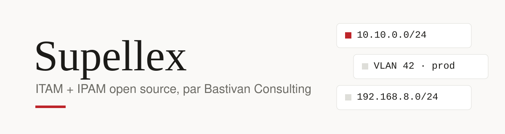

<picture>
  <source width="100%" srcset="assets/banner-dark.svg" media="(prefers-color-scheme: dark)">
  <source width="100%" srcset="assets/banner-light.svg" media="(prefers-color-scheme: light), (prefers-color-scheme: no-preference)">
  
</picture>

<h1 align="center">Supellex</h1>

<p align="center"><b>Nous l'avons construit pour gérer notre parc informatique.<br>Nous le partageons en open source pour gérer le vôtre.</b></p>

<p align="center">Inventaire du parc (ITAM) et gestion des adresses IP (IPAM) en un seul outil&nbsp;: actifs, annuaire, emplacements, VLANs, découverte réseau et pilotage des appareils réseau (VyOS, Cisco, MikroTik). Licence MIT.</p>

<p align="center">
  [<a href="#fonctionnalités">Fonctionnalités</a>]
  [<a href="#installation-rapide">Installation</a>]
  [<a href="#authentification-local-ldap-sso-oidc">Authentification</a>]
  [<a href="#api-extraits">API</a>]
  [<a href="#sécurité-et-conformité">Sécurité</a>]
  [<a href="#licence">Licence</a>]
  [<a href="https://bastivan.consulting">Bastivan Consulting</a>]
</p>

<p align="center">
  <a href="https://github.com/bastivanconsulting/supellex/actions/workflows/ci.yml"></a>
  <a href="https://github.com/bastivanconsulting/supellex/stargazers"></a>
  <a href="https://github.com/bastivanconsulting/supellex/commits"></a>
  
  
  
  
  
  
</p>

<p align="center">
  <a href="#installation-rapide"></a>
  <a href="#fonctionnalités"></a>
  <a href="#licence"></a>
</p>

> [!WARNING]
> **Supellex est en bêta.** Nous le partageons en open source pour proposer une solution d'ITAM + IPAM à la communauté, pas comme un produit prêt pour la production : aucune garantie, aucun support, aucun SLA. Ne l'exposez pas à des données sensibles sans l'avoir audité vous-même, et testez-le d'abord dans un environnement isolé.

> [!TIP]
> **Installation en deux commandes** (docker requis) :
> ```bash
> git clone https://github.com/bastivanconsulting/Supellex && cd Supellex && ./install.sh
> ```
> L'interface est ensuite sur `http://localhost:3000`.

## Sommaire

- [Fonctionnalités](#fonctionnalités)
- [Statut du projet (bêta)](#statut-du-projet-bêta)
- [Installation rapide](#installation-rapide)
- [Architecture](#architecture)
- [Démarrage (dev)](#démarrage-dev)
- [Modèle de données](#modèle-de-données)
- [Authentification (local, LDAP, SSO OIDC)](#authentification-local-ldap-sso-oidc)
- [API (extraits)](#api-extraits)
- [Pilotage des appareils réseau](#pilotage-des-appareils-réseau-vyos-cisco-mikrotik)
- [Sécurité et conformité](#sécurité-et-conformité)
- [Tests](#tests)
- [Identité visuelle](#identité-visuelle)
- [Licence](#licence)

## Fonctionnalités

- [x] **ITAM** : actifs (15 types), statut, n° de série, garantie, annuaire interne, emplacements en arborescence (site > bâtiment > salle > baie), assignations avec historique.
- [x] **IPAM** : espaces IP, domaines VLAN, sous-réseaux imbriqués (CIDR v4/v6), statuts free/allocated/reserved/dhcp/gateway/offline, plages DHCP, règles NAT, tags et champs personnalisés, façon PHPIPAM.
- [x] **Découverte réseau** : balayage ping automatique en arrière-plan + scan à la demande, table ARP pour remplir les MAC, statut `offline` quand une IP ne répond plus.
- [x] **Pilotage des appareils réseau** : VyOS, Cisco et MikroTik par SSH (mot de passe ou clé ed25519/ECDSA) ou API RouterOS, avec test de connexion et provisioning de VLANs/sous-réseaux.
- [x] **Authentification** : comptes locaux, LDAP et SSO (OIDC avec PKCE), provisionnement JIT, rôles mappés depuis les groupes.
- [x] **Sécurité** : secrets chiffrés au repos (AES-256-GCM), JWT révoqués dès qu'un compte est désactivé ou change de rôle, rate limiting sur le login, audit log de toutes les mutations.
- [x] **Open source** : licence MIT, installateur idempotent, déploiement docker ou bare-metal.

## Statut du projet (bêta)

Supellex est une **bêta**. Nous proposons cette solution open source pour aider, sans aucun engagement de notre part : pas de garantie, pas de support, pas de SLA.

**Vérifié** (relevé du 16/11/2026) : 33 tests unitaires passent, dont le flux OIDC complet contre un mock (PKCE, nonce, rôles) et la génération des commandes de provisioning ; `cargo audit` et `pnpm audit` ne remontent aucune vulnérabilité connue ; le build front est reproductible (`pnpm install --frozen-lockfile`) ; l'installateur a été testé en bac à sable.

**Non vérifié, limites connues** : aucun audit de sécurité externe, aucune release taguée ; LDAP et OIDC testés contre des mocks, pas contre un vrai annuaire en conditions réelles ; l'API RouterOS n'a pas été testée contre un vrai routeur MikroTik ; les clés SSH RSA ne sont pas décodées côté client. Avant toute utilisation avec des données réelles : auditez le code, isolez le déploiement, prévoyez vos sauvegardes et un retour arrière.

## Installation rapide

<details open>
<summary><b>Docker</b> (recommandé), stack complète postgres + api + web</summary>

```bash
git clone https://github.com/bastivanconsulting/Supellex && cd Supellex
./install.sh
```

L'installateur génère `.env` (secrets aléatoires, `chmod 600`), construit et démarre les trois services, applique les migrations et crée le compte admin initial (`ADMIN_EMAIL` / `ADMIN_INITIAL_PASSWORD` dans `.env`, à changer au premier login). Il est idempotent : on peut le relancer sans danger.

Déploiement manuel équivalent : `docker compose up -d --build` (voir `docker-compose.yml` ; secrets dans `.env`, voir `.env.example`). Le front est publié sur `${WEB_PORT:-3000}`, l'API sur `127.0.0.1:${API_PORT:-8080}` et n'est joignable que par le BFF web.

</details>

<details>
<summary><b>Bare-metal</b>, build local + unités systemd (user système `supellex`, non-root)</summary>

```bash
sudo ./install.sh --mode bare --systemd
```

Prérequis : docker (uniquement pour PostgreSQL), cargo (stable), node >= `.nvmrc`, pnpm 12 (corepack). Sans `--systemd`, l'installateur peut lancer l'API et le front en arrière-plan (nohup).

</details>

## Architecture

```
navigateur ──cookie HttpOnly──▶ Next.js (BFF /api/*) ──Bearer JWT──▶ API Rust (axum) ──▶ PostgreSQL 17
```

Le token JWT n'est jamais exposé au JavaScript du navigateur : la route `/api/auth/login` de Next pose un cookie `HttpOnly; SameSite=Lax` et le proxy `/api/[...path]` lit ce cookie côté serveur pour forwarder le JWT à l'API.

| Composant | Tech | Dossier |
|---|---|---|
| API | Rust stable, axum 0.8, sqlx 0.9 (PostgreSQL), argon2id, JWT (HS256) | `apps/api` |
| Front | Next.js 16 + TypeScript 6.0.3 strict, Tailwind v4, pnpm 12 workspace | `apps/web` |
| Types partagés | package `@supellex/types` | `packages/types` |
| DB | PostgreSQL 17 (docker-compose) | `docker-compose.yml` |

## Démarrage (dev)

```bash
# 1. Secrets : copier .env.example en .env, puis générer chaque valeur
#    aléatoirement, ex. : openssl rand -base64 32
cp .env.example .env && $EDITOR .env

# 2. Base de données
POSTGRES_PASSWORD=<valeur> docker compose up -d postgres

# 3. API (migrations auto au démarrage, compte admin seedé avec
#    mot de passe à changer : ADMIN_INITIAL_PASSWORD)
cd apps/api && cargo run

# 4. Front
pnpm install && pnpm --filter supellex-web dev   # http://localhost:3000
```

Node : version du `.nvmrc` (LTS 26.13.1, `engines` identique). Rust : toolchain stable à jour (`rust-toolchain.toml`). pnpm 12 (dernière stable, pin `packageManager` dans le `package.json` racine, servi par corepack). TypeScript 6.0.3 : TS 7 n'est pas encore supporté par typescript-eslint (lint), 6.0.3 est le max de la plage `>=4.8.4 <6.1.0`.

## Modèle de données

- **users** : comptes d'accès, rôles `viewer < operator < admin`, hash argon2id
- **people** : annuaire interne (personnes recevant du matériel)
- **locations** : arborescence site > bâtiment > salle > baie
- **assets** : actifs (15 types), statut, n° de série, garantie, assignation + historique `asset_assignments`
- **ip_spaces / vlan_domains / vlans / subnets / ip_addresses** : IPAM (CIDR v4/v6, gateway, DNS, statuts free/allocated/reserved/dhcp/gateway/offline, sous-réseaux imbriqués via `master_subnet_id`)
- **vlan_domains** : un VID est unique par domaine (comme PHPIPAM)
- **tags / ip_tags**, **dhcp_ranges**, **nat_rules**, **field_defs** (+ `custom_fields` JSONB sur IP et sous-réseaux) : fonctions façon PHPIPAM
- **découverte réseau** : balayage ping automatique en arrière-plan (`PING_INTERVAL_SECONDS`) + scan à la demande (`POST /ipam/subnets/{id}/scan`), table ARP pour remplir les MAC, statut `offline` quand une IP ne répond plus
- **audit_log** : toute mutation tracée (acteur, action, entité, IP, détails JSON)

## Authentification (local, LDAP, SSO OIDC)

Trois sources, cumulables, configurables dans l'UI admin (**Authentification**, `/settings/auth`) ou par l'API (`/auth-providers`, admin) :

- **Local** (toujours actif) : comptes en base, hash argon2id, changement de mot de passe forcé à la création.
- **LDAP** : bind compte de service + recherche (`user_filter` avec `{login}` échappé RFC 4515) puis bind utilisateur pour vérifier le mot de passe, ou bind direct via `user_dn_template`. LDAPS ou StartTLS (rustls). Attributs e-mail / nom / groupes configurables (`mail`, `displayName`, `memberOf`).
- **SSO / OIDC** : flux authorization code + PKCE, state one-shot en base (10 min), vérification de l'id_token (signature JWKS, iss, aud, exp, nonce). Claims e-mail / nom / rôles configurables (chemins pointillés supportés, ex. `realm_access.roles`). Le bouton SSO redirige vers le fournisseur ; `redirect_uri` par défaut = `<PUBLIC_BASE_URL>/api/auth/oidc/callback`.

Pour LDAP et OIDC : provisionnement JIT du compte à la première connexion (`jit_provision`), rôle déduit du `role_map` (rôle le plus élevé gagne, `default_role` sinon, resynchronisé à chaque login si `sync_roles`, sans jamais rétrograder le dernier admin). Les secrets des fournisseurs (bind LDAP, client_secret OIDC) sont chiffrés au repos AES-256-GCM (préfixe `enc:`, AAD distinct) et jamais renvoyés par l'API. Le rate limiting du login s'applique à toutes les sources. `POST /auth-providers/{id}/test` diagnostique la connexion (bind service LDAP / discovery OIDC).

## API (extraits)

| Méthode | Route | Rôle min |
|---|---|---|
| POST | `/auth/login` `{email, password, source?}` | public |
| GET | `/auth/providers` (liste publique pour la page de login) | public |
| GET | `/auth/oidc/{slug}/start` → `{authorization_url}` | public |
| GET | `/auth/oidc/callback?code&state` → émet le JWT | public |
| GET | `/auth/me` | auth |
| POST | `/auth/change-password` | auth |
| CRUD | `/auth-providers`, POST `/{id}/test` | admin |
| GET/POST | `/users`, PATCH/DELETE `/users/{id}` | admin |
| CRUD | `/people`, `/locations`, `/assets` | viewer (lecture) / operator (écriture) |
| POST | `/assets/{id}/assign` | operator |
| CRUD | `/ipam/spaces`, `/ipam/vlans`, `/ipam/subnets` | operator |
| GET | `/ipam/subnets/{id}/ips`, POST idem (allocation auto si `address` omis) | viewer / operator |
| GET | `/ipam/subnets/{id}/next-free`, `/{id}/children`, POST `/{id}/scan` | viewer / operator |
| PUT/POST | `/ipam/ips/{id}`, POST `/ipam/ips/{id}/ping`, PUT `/ipam/ips/{id}/tags` | operator |
| CRUD | `/ipam/vlan-domains`, `/ipam/tags`, `/ipam/dhcp`, `/ipam/nat`, `/ipam/fields` | operator (fields: admin) |
| GET | `/search?q=…` (IP/MAC/hostname, sous-réseaux, actifs, personnes, VLANs) | viewer |
| GET | `/ipam/vlans/{id}/subnets` | viewer |
| GET | `/audit` | admin |
| CRUD | `/devices`, `/{id}` | viewer (lecture) / operator (écriture) / admin (suppression) |
| POST | `/devices/{id}/test` (connexion + `show version` / `/system resource print`) | operator |
| POST | `/devices/{id}/provision` `{vlan_ids, subnet_ids}` (pousse VLANs + sous-réseaux) | operator |

## Pilotage des appareils réseau (VyOS, Cisco, MikroTik)

Le module **Appareils** pilote les routeurs/switches manageables :

- **Transports** : SSH (mot de passe ou clé privée ed25519/ECDSA) pour les trois plateformes ; API RouterOS native (TCP 8728, protocole mot-à-mot implémenté dans `device_net.rs`, login moderne RouterOS ≥ 6.43) pour MikroTik.
- **Provisioning** : `POST /devices/{id}/provision` génère les commandes (`provision.rs`, testé unitairement) puis les pousse : VLANs d'abord, puis adressage des sous-réseaux (SVI Cisco `interface Vlan{id}`, vif VyOS `set interfaces ethernet <uplink> vif <vid> address …`, `/interface vlan add` + `/ip address add` MikroTik). Session enveloppée (`configure terminal` / `configure` + `commit` + `save`).
- **Sécurité** : secrets chiffrés au repos AES-256-GCM (clé `DEVICES_ENCRYPTION_KEY`, base64 32 octets) et **jamais** renvoyés par l'API ; empreinte SHA256 de la clé hôte SSH épinglée au premier contact (TOFU, refus si elle change ensuite) ; chaque test/provisionnement est tracé dans `audit_log` ; timeouts bornés (connexion 15 s, exécution 60 s).
- Limitation connue : les clés SSH **RSA** ne sont pas décodées côté client (conflit de versions `rsa` avec `jsonwebtoken`) : utiliser ed25519/ECDSA ou un mot de passe.

Validations IPAM : CIDR parsé, gateway dans le sous-réseau, pas de chevauchement de sous-réseaux dans un même espace (sauf enfant contenu dans son master), MAC normalisée + refusée si déjà liée à une autre IP active, hostname RFC 1123, plages DHCP contenues dans le sous-réseau et sans chevauchement, champs personnalisés validés contre `field_defs` (type + requis + select).

## Sécurité et conformité

Contribution ISO 27001 A.8.x, NIS2 art. 21, DORA.

- aucun secret en dur : variables d'environnement, `.env*` gitignoré et exclu des images docker (`.dockerignore`), secrets générés aléatoirement par `install.sh`
- entrées validées (validator + SQL paramétré sqlx, jamais de SQL dynamique concaténé ; filtres LDAP échappés RFC 4515, DN échappés RFC 4514)
- JWT Bearer, RBAC vérifié côté serveur à chaque route, refus par défaut
- auth externe : PKCE + state one-shot + nonce OIDC vérifié, secrets fournisseurs chiffrés au repos (AES-256-GCM, AAD distinct) et masqués dans l'API, JIT avec protection du dernier admin, TLS rustls (vérification certificat désactivable explicitement, seulement pour les tests)
- révocation immédiate des tokens : à chaque requête, le compte doit être actif et son rôle en base doit correspondre au rôle du token (désactiver un compte ou changer son rôle invalide ses sessions)
- rate limiting anti force brute sur `/auth/login` (fenêtre glissante par IP, `LOGIN_MAX_ATTEMPTS`/`LOGIN_WINDOW_SECONDS`, 429) ; l'IP réelle est forwardée par le BFF via `X-Forwarded-For` (l'API ne doit être joignable que par le BFF)
- mots de passe argon2id, changement forcé au premier login
- cookie HttpOnly/SameSite côté front, en-têtes de sécurité front (CSP, HSTS, X-Frame-Options, X-Content-Type-Options, Referrer-Policy, Permissions-Policy) posés par `next.config.ts`, CORS restreint, corps limité à 1 Mo, timeout 30 s
- audit log de toutes les mutations + identifiant de corrélation par requête (`x-correlation-id`)
- secrets des appareils réseau chiffrés au repos (AES-256-GCM), jamais exposés par l'API, jamais logués
- erreurs : message générique au client, détail uniquement en log
- `cargo fmt`, `cargo clippy -- -D warnings`, `cargo test`, `cargo audit` propres (ignores documentés dans `apps/api/.cargo/audit.toml`)
- front : `pnpm lint` (eslint) et `pnpm audit` propres
- conteneurs : exécution sans root (user `supellex` pour l'API, `node` pour le front), images épinglées (`rust:1.100-bookworm`, `node:26.13.1-alpine`, `postgres:17-alpine`), `.env` exclu du contexte de build ; en systemd (`install.sh --mode bare --systemd`) : user système `supellex`, `NoNewPrivileges`, `ProtectSystem=full`, `CAP_NET_RAW` limité à l'API (ping)

## Tests

La CI GitHub Actions (badge ci-dessus) exécute à chaque push et PR : `cargo fmt --check`, `cargo clippy -D warnings`, `cargo test`, `cargo audit` (base RUSTSEC), `pnpm install --frozen-lockfile`, `eslint`, `tsc --noEmit`, `next build`, `pnpm audit`, un scan gitleaks de tout l'historique (secrets) et `docker compose config`. Les macros sqlx sont vérifiées à la compilation contre un PostgreSQL de service.

En local :

```bash
cd apps/api && cargo test          # tests unitaires + flux OIDC complet contre un mock (PKCE, nonce, rôles)
cd apps/api && cargo audit         # 0 vulnérabilité (ignores documentés dans apps/api/.cargo/audit.toml)
pnpm --filter supellex-web lint     # eslint 10 (flat config), 0 erreur 0 warning
pnpm audit                         # 0 vulnérabilité (override minimatch, voir pnpm-workspace.yaml)
pnpm --filter supellex-web build    # build front (tsc strict + Tailwind v4)
```

## Identité visuelle

Thème clair de la charte Bastivan Consulting (bastivan.consulting) : accent `#bd252a`, fonds `#faf9f7`/`#ffffff`, lignes `#deded9`, logo `logo-bastivan-light-bg.png` servi depuis `apps/web/public/` (sidebar + login). Charte design appliquée : deux polices système max (serif éditorial `font-display` pour les titres, sans pour le corps (jamais Inter/Roboto), corps 17 px / interligne 1,6 aligné à gauche, titres en sentence case, chiffres tabulaires dans les tableaux, un seul jeu d'icônes SVG inline sobre (composant `Icon`), zéro émoji, pas de dégradés, focus visibles (anneau accent) sur tous les contrôles.

## Licence

MIT (voir `LICENSE`). Copyright (c) 2026 Bastivan Consulting SAS, 14 boulevard du Docteur Lamotte, 60000 Beauvais. Contact : contact@bastivan.com.
